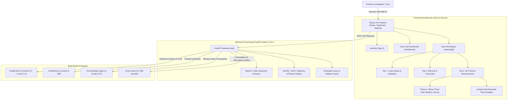

# Technical Requirements Document (TRD)

**Project Name:** ChronoSense Forensics (Spark Forensics)  
**Hackathon Team:** Team Spark (`HFT26-TEAM-9`)  
**Track:** Computer Vision & Intelligent Systems  
**Status:** Approved & Finalized  
**Version:** 1.0.0  

---

## 1. System Architecture

The ChronoSense system consists of three distinct layers:
1. **Frontend Presentation & 3D WebGL Layer** (`frontend/`)
2. **Forensic & Computer Vision API Layer** (`backend/`)
3. **AI Inference & LLM/VLM Infrastructure** (Featherless AI + Groq Cloud)



---

## 2. Directory Layout & Separation of Concerns

To ensure maintainability and clean development separation, the project is structured as follows:

```
HFT26-TEAM-9/
├── design/                         # [DEDICATED] Design, PRD, TRD, Schemas & UI Specs
│   ├── PRD.md                      # Product Requirements Document
│   ├── TRD.md                      # Technical Requirements Document
│   ├── UI_UX_SPEC.md               # Wireframes, layout hierarchy & color palette
│   └── DATA_SCHEMA.md              # JSON schemas & mock case datasets
│
├── frontend/                       # Next.js 14 Web Application
│   ├── app/                        # Next.js App Router pages
│   │   ├── page.tsx                # Landing Page
│   │   ├── dashboard/page.tsx      # Case Management Hub
│   │   └── cases/[id]/             # Case Workspace (Details, Records, Visual)
│   │       └── page.tsx
│   ├── components/                 # UI & 3D Components
│   │   ├── 3d/                     # Three.js / React Three Fiber components
│   │   │   ├── Scene.tsx           # 3D Intersection, roads, traffic lights
│   │   │   ├── Vehicle.tsx         # 3D Vehicle bounding box/models
│   │   │   ├── TrajectoryTrail.tsx # Spline trajectory lines
│   │   │   └── CameraControls.tsx  # Top-down / POV / Orbit camera switcher
│   │   ├── dashboard/              # Case cards, create modal, search/filter
│   │   ├── workspace/              # Details tab, Records tab, Contradiction badges
│   │   └── timeline/               # Scrubbable timeline slider with event markers
│   ├── store/                      # Zustand state store (timeline scrub time, active case)
│   ├── public/                     # Static assets (sample video clips, audio wavs, models)
│   └── package.json
│
├── backend/                        # FastAPI Python Service
│   ├── app/
│   │   ├── main.py                 # FastAPI application entrypoint
│   │   ├── routers/                # API route controllers
│   │   │   ├── cases.py            # Case CRUD & metadata
│   │   │   ├── evidence.py         # Evidence upload & dynamic injection
│   │   │   └── reconstruction.py   # Trajectory calculation & contradiction engine
│   │   ├── services/
│   │   │   ├── featherless_service.py # Featherless VLM & LLM client
│   │   │   ├── groq_service.py        # Groq Whisper & Llama-3.3 client
│   │   │   ├── video_service.py       # OpenCV frame extractor
│   │   │   └── trajectory_service.py  # SciPy cubic spline physics generator
│   │   └── data/                      # Embedded SQLite / preloaded JSON demo cases
│   ├── requirements.txt
│   └── .env.example
│
└── README.md                       # Official Hackathon starter & project presentation
```

---

## 3. Data Schemas & Contracts

### 3.1 Case Schema (`CaseModel`)
```typescript
interface CaseModel {
  id: string;                     // e.g., "CASE-101"
  title: string;                  // e.g., "Main St & 4th Ave Intersection Collision"
  date: string;                   // ISO 8601 string
  location: string;               // e.g., "Junction of Main St & 4th Ave, Downtown"
  investigatingOfficer: {
    name: string;
    badge: string;
    department: string;
  };
  status: "OPEN_INVESTIGATION" | "CONTRADICTION_FLAGGED" | "RESOLVED";
  overallConfidence: number;      // 0.0 to 1.0 (e.g. 0.86)
  summary: {
    executive: string;            // AI-synthesized paragraph
    inferences: string[];         // Probabilistic hypotheses
    observations: string[];       // Verified physical facts
  };
  evidenceCount: {
    video: number;
    audio: number;
    sensor: number;
    text: number;
  };
}
```

### 3.2 Evidence Record Schema (`EvidenceItem`)
```typescript
interface EvidenceItem {
  id: string;                     // e.g., "EV-001"
  caseId: string;
  type: "VIDEO" | "AUDIO" | "SENSOR" | "WITNESS_TEXT";
  sourceName: string;             // e.g., "Dashcam Vehicle A (BlackVue 4K)"
  timestampRecorded: string;
  fileUrl: string;
  transcriptOrExtractedText?: string;
  extractedObservations: Array<{
    timestampSec: number;
    observation: string;
    confidence: number;
    isGroundTruth: boolean;
  }>;
}
```

### 3.3 Timeline Event Schema (`TimelineEvent`)
```typescript
interface TimelineEvent {
  id: string;
  timeSec: number;                // Relative seconds from T0 (e.g., 2.45)
  isoTime: string;                // "14:02:11.45"
  title: string;                  // "Vehicle A enters intersection"
  description: string;
  category: "MOVEMENT" | "SIGNAL_CHANGE" | "BRAKE_ACTION" | "IMPACT" | "POST_COLLISION";
  classification: "RAW_OBSERVATION" | "INFERRED_HYPOTHESIS";
  confidenceScore: number;        // e.g., 0.94
  evidenceReferences: string[];   // ["EV-001", "EV-003"]
  hasContradiction: boolean;
  contradictionId?: string;
}
```

### 3.4 Contradiction & Gap Schema (`ContradictionAlert`)
```typescript
interface ContradictionAlert {
  id: string;
  timestampSec: number;
  severity: "HIGH" | "MEDIUM" | "GAP";
  topic: string;                  // e.g., "Traffic Light State"
  claimA: {
    sourceId: string;
    sourceType: "AUDIO_WITNESS";
    statement: "Vehicle A had a red light and sped through.";
    credibility: 0.62;
  };
  claimB: {
    sourceId: string;
    sourceType: "VIDEO_DASHCAM";
    statement: "Traffic light in Frame #412 was illuminated Green.";
    credibility: 0.98;
  };
  systemResolution: string;       // "Video ground truth overrides witness recollection. Tagged as witness memory distortion."
}
```

### 3.5 3D Trajectory Frame Schema (`TrajectoryFrame`)
```typescript
interface TrajectoryFrame {
  timeSec: number;                // 0.0 to 8.0 seconds (step: 0.1s)
  vehicles: {
    [vehicleId: string]: {
      x: number;                  // 3D world coordinates (meters)
      z: number;
      speedKmh: number;
      headingDeg: number;
      braking: boolean;
      uncertaintyRadiusMeters: number; // Error ellipse (e.g. ±0.8m)
    };
  };
  trafficLights: {
    northSouth: "GREEN" | "YELLOW" | "RED";
    eastWest: "GREEN" | "YELLOW" | "RED";
  };
  isImpactPoint: boolean;
}
```

---

## 4. API Endpoints Specification

### 4.1 Case Management
- `GET /api/cases`: Returns array of `CaseModel` for the Dashboard grid.
- `GET /api/cases/{id}`: Returns complete case workspace bundle (details, records, timeline, contradictions, trajectory).
- `POST /api/cases`: Accepts multipart/form-data (video, audio, text, sensor) -> triggers initial analysis pipeline -> returns created case.

### 4.2 Dynamic Evidence Processing ("Add Evidence")
- `POST /api/cases/{id}/evidence`:
  - Uploads a new evidence record.
  - Automatically re-runs Groq/Featherless cross-referencing.
  - Returns updated `TimelineEvent[]`, `ContradictionAlert[]`, and recalculated `summary`.

### 4.3 Trajectory Stream
- `GET /api/cases/{id}/trajectory`:
  - Returns the pre-calculated array of `TrajectoryFrame[]` for Three.js timeline scrubbing.

---

## 5. AI Service Integration Specs

### 5.1 Featherless AI Client Configuration
```python
# backend/app/services/featherless_service.py
from openai import OpenAI

featherless_client = OpenAI(
    base_url="https://api.featherless.ai/v1",
    api_key=os.getenv("FEATHERLESS_API_KEY")
)

# Vision Model for Keyframes
VLM_MODEL = "Qwen/Qwen2-VL-7B-Instruct"

# Timeline Synthesis LLM
LLM_MODEL = "meta-llama/Meta-Llama-3.1-70B-Instruct"
```
* **Payload**: OpenCV encodes keyframes into base64 JPEG strings and sends them to `Qwen2-VL` with a system prompt instructing structured JSON output identifying vehicle coordinates, colors, and traffic signals.

### 5.2 Groq Cloud Client Configuration
```python
# backend/app/services/groq_service.py
from groq import Groq

groq_client = Groq(api_key=os.getenv("GROQ_API_KEY"))

# Audio Speech-to-Text
WHISPER_MODEL = "whisper-large-v3"

# Contradiction Engine
REASONING_MODEL = "llama-3.3-70b-versatile"
```
* **Latency Guarantee**: Groq transcribes a 30-second audio clip in $\sim 0.6$ seconds and performs complex multi-claim contradiction matrix reasoning in $< 1.2$ seconds.

---

## 6. 3D WebGL Visualization Specification

### 6.1 Coordinate & Physics Convention
- **World Unit**: $1\text{ unit} = 1\text{ meter}$.
- **Ground Plane**: Standard asphalt 4-way intersection centered at $(X=0, Z=0)$ with road width $= 7.0\text{m}$ (2 lanes per direction).
- **Vehicles**:
  - `Vehicle A` (Sedan): Red bounding body ($4.5\text{m} \times 1.8\text{m} \times 1.4\text{m}$).
  - `Vehicle B` (SUV): Blue bounding body ($4.8\text{m} \times 2.0\text{m} \times 1.7\text{m}$).
- **Trajectory Interpolation**:
  - SciPy cubic spline (`scipy.interpolate.CubicSpline`) calculates continuous vehicle $(x, z)$ coordinates between discrete vision-detected anchor frames.
  - Heading angle $\theta$ is calculated tangent to the displacement vector: $\theta = \arctan2(\Delta x, \Delta z)$.

### 6.2 Camera Perspectives
1. **Bird's-Eye (Forensic Top-Down)**: Camera position `[0, 45, 0]`, looking straight down at `[0, 0, 0]`. Ideal for judging vehicle trajectories and stopping distances.
2. **Vehicle A Driver POV**: Camera mounted at `[x_a, 1.2, z_a]`, rotated along vehicle heading $\theta_a$.
3. **Free Orbit (Judge Inspection)**: Enabled via `@react-three/drei` `OrbitControls` with zoom and tilt constraints.

---

## 7. Resilience & Hackathon Fallback Strategy

To guarantee that live demos never fail during judging (regardless of WiFi outages or API rate limits):
1. **Local Static Cache**: Pre-bundled complete JSON responses for **Case #101 (T-Bone Collision)** and **Case #102 (Multi-Vehicle Rear-End)** located directly in `backend/app/data/sample_cases.json` and mirrored in `frontend/public/data/`.
2. **Auto-Fallback Hook**: If `FEATHERLESS_API_KEY` or `GROQ_API_KEY` is missing or returns a `5xx`/timeout, the backend instantly falls back to the deterministic local engine, completing the workflow in $< 500\text{ms}$ with zero UI disruption.

